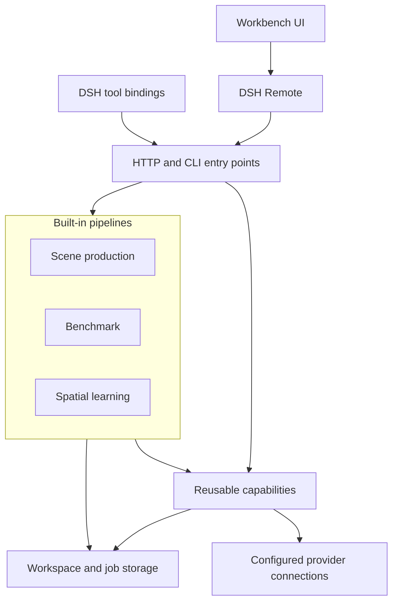

# BenchForge

BenchForge composes reusable capabilities into three built-in pipelines for scene production, benchmark development, and spatial learning. The command line and HTTP service expose both workflows and individual capabilities. The DSH plugin adds one BenchForge preset with an expandable workbench. DSH is supplied by the pinned `deepseek-harness4BenchForge` submodule.



## 源码目录

| 目录 | 职责 |
| --- | --- |
| [`src/capabilities/`](src/capabilities/) | 独立的场景、资产、采集、数据集、任务目录、评分与训练执行能力。 |
| [`src/pipelines/`](src/pipelines/) | 三个内置流程的阶段顺序、配方、验收和实验策略。流程调用独立能力。 |
| [`src/server/`](src/server/) | HTTP 和 CLI 入口，装配流程、能力和作业存储。 |
| [`src/storage/`](src/storage/) | 文件、工作区作业、场景队列、阶段审查和训练记录。 |
| [`src/service_access/`](src/service_access/) | 服务配置、HTTP/OpenAI 客户端、运行上下文及进程控制。 |
| [`src/dsh/`](src/dsh/) | DSH 的单一预设、工具注册、Host 投影与 Typert Remote 契约。 |
| [`src/ui/`](src/ui/) | 可展开的评测工作台和独立的训练监控页面。 |

能力、存储和服务访问只依赖底层模块。`pipelines/`、`server/`、`ui/` 和 `dsh/` 由上层装配。
工作台通过 DSH Remote 读取和提交数据，训练监控通过自身的 HTTP 入口访问训练记录。
[完整源码目录与依赖边界](src/README.md) 展示所有层级。

`config/` 提供部署配置，`third_party/` 提供固定版本的外部模型和仿真源码。

## 独立部署与统一 Agent 预设

下方提供 Linux 服务机的完整安装步骤，可在另一台机器或另一目录部署，
不需要已有 FIT 服务、旧 DSH 配置或其他分支的文件。按顺序执行
[独立部署指令](#独立部署指令linux)，先启动 Web、BenchForge 和独立数据库。

本分支安装一个自定义 **BenchForge** 预设（`benchforge`）。
“评测工作台”按钮展开、收起右侧工作台；切换显示保留同一会话、输入草稿和执行状态。

基础安装不需要 GPU、模型密钥或 Isaac Sim。模型问答、图像生成和仿真采集需要另外配置对应服务。

## Current capabilities

- **Harness and workflows:** DSH plugin integration; a catalog of 89 tasks and 267 measurement templates; persistent pipelines that can resume; stage reviews; model and simulator adapters.
- **BenchForge:** scene programs, asset generation, simulation queue, capture evidence, operator review, and public data export. See the [integration guide](src/dsh/README.md).
- **Evidence and delivery:** keep model-visible questions separate from authority answers; record source and capture evidence; validate declared public assets before packaging.
- **Evaluation and training:** deterministic local scoring, dataset packaging, spatial capability templates, and local training tools.

The task/template catalog and the separate spatial-learning capability graph serve different purposes. Model predictions are candidate annotations, not ground truth. Ground truth must be derived from an accepted official source, executable task, or simulator evidence.

## Third-party provider libraries

[`third_party/`](third_party/README.md) includes pinned Git submodules for
the DSH runtime, FastTrellis2, DSpark4A100, IsaacSim4A100, FastSAM3, FastFLUX2Klein, FastDA3, and FastQwen.
After pulling this repository, download their sources with:

```bash
git submodule sync --recursive
git submodule update --init --recursive --depth 1
```

These providers are optional for the base installation. Follow each provider's
own README to install its environment, weights, and service.

## Configuration

`config/benchforge.example.json` is the configuration template. `benchforge_app.py init` creates the private `config/benchforge.local.json`. Set ports, paths, models, the database, and the Isaac Sim gRPC endpoint in that file. `benchforge_app.py sync` generates the runtime files used by BenchForge, DSH, and Compose.

BenchForge uses one server configuration as the source for its execution mode and scene policy. In `production` mode, a valid scene policy is required. The client and DSH plugin read the resolved service URL and credentials without changing the server's environment.

The root `.gitignore` excludes local configuration and generated output.

## Verification

CI builds the DSH bundle and checks installation and CLI startup on Windows and Linux. The scene production service uses Python 3.12 in CI.

## 独立部署指令（Linux）

以下命令在 **Linux 服务器的 Bash 终端**执行，只有第 6 节的 SSH 隧道在自己的
电脑上执行。每一组成功后再执行下一组；失败时先处理错误，避免拿半安装状态启动。
示例选择 Web `3092`、API `3858`、数据库 `55548`，可在第 3 节改成自己的空闲端口。

### 0. 准备运行环境

| 软件 | 要求 | 检查命令 |
| --- | --- | --- |
| Git | **2.26 或更新**，DSH 安装脚本有此要求 | `git --version` |
| Python | 完整部署用 3.11、3.12 或 3.13，并包含 venv/ensurepip | `python3.11 --version` |
| Node.js / npm | Node 24.9 或更新 | `node --version`、`npm --version` |
| Docker Engine / Compose | 当前用户可使用 Docker；Compose v2 支持 `--wait` | `docker info`、`docker compose version` |
| 系统工具 | `bash`、`ss`、`curl`、`setsid`、C/C++ 编译工具 | `command -v bash ss curl setsid cc make` |
| bubblewrap | 执行隔离任务代码时使用；基础页面验收不调用它 | `command -v bwrap` |

本文统一用 `python3.11` 创建环境；已经安装 3.12/3.13 时，只需把下面创建环境的
`python3.11` 换成该命令，后续都使用 `.venv/bin/python`。系统的 `python3` 可能仍是
3.8，不要仅凭命令存在就继续。需要联网下载 GitHub 源码、npm/PyPI 包和 PostgreSQL 镜像。

**已有 Conda 时，推荐创建专用环境，避免修改其他项目的 Git、Node 或 Python：**

```bash
# 新终端找不到 conda 时，先加载自己安装位置的初始化脚本。
# Miniconda 默认位置：
source "$HOME/miniconda3/etc/profile.d/conda.sh"
# Miniforge 用户改用：source "$HOME/miniforge3/etc/profile.d/conda.sh"

conda create -n benchforge --override-channels -c conda-forge \
  --repodata-fn current_repodata.json python=3.11 nodejs=24 'git>=2.26' -y
conda activate benchforge
git --version
python3.11 --version
node --version
npm --version
```

如果长时间停在 `Collecting package metadata`，先按 Ctrl+C 结束这次创建，再用
[TUNA 的 conda-forge 镜像](https://mirrors.tuna.tsinghua.edu.cn/help/anaconda/) 重试。
下列命令只为本次创建选择镜像，不修改其他项目的全局 Conda 配置：

```bash
conda create -n benchforge --override-channels \
  -c https://mirrors.tuna.tsinghua.edu.cn/anaconda/cloud/conda-forge \
  --repodata-fn current_repodata.json python=3.11 nodejs=24 'git>=2.26' -y
conda activate benchforge
git --version
python3.11 --version
node --version
npm --version
```

若提示 `benchforge` 已存在，先激活并检查版本；已有环境符合要求时直接使用，
不符合时为新环境换一个名字，保留旧环境。

没有 Conda 可先按 [Miniforge 官方安装说明](https://github.com/conda-forge/miniforge#install)
安装，然后执行上述创建环境的命令；已有符合版本要求的工具可跳过创建环境。
再次登录服务器后，先 `conda activate benchforge`，再进入仓库目录。

Ubuntu/Debian 缺少系统工具时，管理员可执行：

```bash
sudo apt-get update
sudo apt-get install -y build-essential curl ca-certificates iproute2 util-linux bubblewrap
```

`benchforge_task_code` 强制在 bubblewrap 中执行 Python；DSH 会话的
`danger-full-access` 不会取消这层隔离。没有 sudo 时，可由管理员提供兼容的
非 setuid `bwrap`，或按 [bubblewrap 上游说明](https://github.com/containers/bubblewrap)
编译到用户目录。把其 `bin` 目录加入 **BenchForge 后端与 DSH 启动进程的 PATH**，
再重启这两个服务。仅修改交互终端的 PATH 不会更新已经运行的服务。
这种安装需要主机允许非特权 user namespaces；不能仅凭 `bwrap --version` 判断可用。
应实际运行隔离命令，并通过 `benchforge_task_code` 验证任务文件可写、源码和资产只读、
主机网络不可达。缺少沙箱时工具拒绝执行，不会自动降级为无隔离运行。

Docker 尚未安装时，按 [Docker 官方 Linux 安装说明](https://docs.docker.com/engine/install/)
选择系统，安装 Engine 和 Compose plugin。普通用户访问权限按
[安装后配置](https://docs.docker.com/engine/install/linux-postinstall/) 设置；
重新登录后确认下面两条命令成功，再继续。不要为了绕过权限问题用 sudo 运行整套 Python/DSH。

```bash
docker info
docker compose version
```

### 1. 下载 main 到新目录

`benchforge-3092` 是示例部署的独立目录名；已有同名目录时换一个新名称。

```bash
cd "$HOME"
git -c http.version=HTTP/1.1 clone --branch main --single-branch https://github.com/EurecaMoment/BenchForgeV2.git benchforge-3092
cd benchforge-3092
git branch --show-current
```

最后一行应输出 `main`。之后所有服务器命令都在这个目录执行。
不要复制旧部署的 `config/`、`.benchforge/` 或 `.benchforge/backend/`。
`-c http.version=HTTP/1.1` 仅对本次克隆生效，用于减少部分网络链路上的 GitHub
连接中断，不修改全局 Git 配置。若下载仍失败，保留错误并检查网络；重试前确认目标
目录尚未创建，已有目录则换新名称，不要删除已有部署。

### 2. 安装 Python 后端与 Node 插件

```bash
python3.11 -m venv .venv
.venv/bin/python -m pip install -e '.[dsh,production,research]'
npm ci --prefix src/dsh
.venv/bin/python benchforge_app.py setup
```

`.venv/` 是核心与 DSH 辅助程序环境，`.benchforge/backend/venv/` 是后端环境。
`npm ci --prefix src/dsh` 安装插件依赖，生成工作台的 Typert 声明，编译 Host 服务并打包 Web Client。
这一步完成后还没有启动服务，也没有配置模型或仿真器。

### 3. 初始化本实例配置

先检查这三个端口；没有输出表示当前未被监听。如有输出，换三个空闲端口，并在
后面的初始化、启动和隧道命令中使用对应数值。不要停止别人占用端口的进程。

```bash
ss -ltnp | grep -E ':(3092|3858|55548)\b' || true
```

```bash
.venv/bin/python benchforge_app.py init \
  --web-port 3092 --port 3858 --db-port 55548 --project benchforge-3092
```

之后只编辑 **`config/benchforge.local.json`**。同机部署多套实例时，每套使用独立的
`database.project` 和端口。重复执行 `init` 会使用本机文件中的既有配置。

| 配置键 | 用途 |
| --- | --- |
| `dsh` | 从配置模板同步的 DSH fork、子模块路径、版本和构建要求。实际提交由 Git 子模块指针锁定。 |
| `web.port` | DSH Web 端口。可用 `BENCHFORGE_WEB_PORT` 临时覆盖。 |
| `web.default_workspace` | DSH 的默认工作区目录。支持绝对路径和相对配置文件目录的路径。启动时创建或复用目录并登记工作区。值为 `null` 时沿用 DSH 的默认行为。 |
| `server` | 本机 BenchForge API 端口、对客户端公开的服务地址、产物目录、场景策略和认证环境变量名。 |
| `database` | PostgreSQL 端口、Compose 项目名和密码环境变量名。复用外部数据库时设置 `url` 或 `url_env`。 |
| `client` | DSH 和 CLI 连接的 BenchForge 后端。默认使用本机服务，亦可填 `service_config` 或 `service_url`。 |
| `providers` | 六个 `third_party/` 提供方。包括 OpenAI 对话模型、四个 HTTP 工具和 Isaac 采集。 |

`init` 和 `sync` 生成 `config/generated/` 下的服务端、客户端和 Compose 配置。
启动服务会自动建立并验证独立的 PostgreSQL 只读角色，凭据保存在本机私有配置中。复用外部数据库时，服务账号需要 `CREATEROLE`，或在 `database.reader_url_env` 指定已有受限只读连接的环境变量名；缺少权限会明确停止，不会使用管理员连接代替模型查询。
`dsh-setup` 生成 DSH 预设。配置中的相对路径以 `config/benchforge.local.json` 所在目录为基准。
例如将 `web.default_workspace` 设为 `../workspaces/benchforge`，重启后 Web 在没有已选工作区时使用该目录。
已有部署更新 DSH 子模块版本后，先运行 `python benchforge_app.py dsh-setup` 构建锁定的 DSH，再启动 Web。
模型密钥通过各字段指定的环境变量传入。首次初始化会为本实例生成缺省的数据库密码和服务令牌，
保存在被 Git 忽略的部署状态里。

### 4. 安装 DSH 并生成完整预设

```bash
.venv/bin/python benchforge_app.py dsh-setup
```

此命令初始化 `third_party/deepseek-harness4BenchForge/` 子模块，构建配置中注明的 DSH `0.2.2-rc.3`，
然后按本机配置生成含统一预设和工作台插件的
`config/generated/benchforge.local.yml` 与
`.benchforge/runtime.json`。首次源码构建可能需要数分钟，最后应看到
`Ready. Run: python benchforge.py start`，且命令退出码为 0。

这里必须使用 **`dsh-setup`**（或下方等价命令），它会将第 3 节的服务配置接入预设：

```bash
# 与上一条二选一，不需要重复执行。
.venv/bin/python benchforge.py setup --benchforge-config config/generated/benchforge-client.local.json
```

`benchforge.py setup` 默认使用本实例的 `config/generated/benchforge-client.local.json`。
从旧版升级时先重新执行第 2 节的 `npm ci --prefix src/dsh`，再运行 `dsh-setup` 以更新预设。已有手工模型配置时先备份本地 YAML。
DSH 本身默认通过锁定的 pnpm 版本安装；不需要复制另一部署的 DSH。

如果此步骤在下载 DSH 时出现 `unexpected eof`、`SSL_read` 或 `schannel` 连接错误，
先确认网络恢复。使用 Git 2.31+（上方推荐的 Conda 环境满足要求），可按下面的方式
重试，让本次安装调用的 Git 也使用 HTTP/1.1；这些环境变量只在该命令中生效：

```bash
GIT_CONFIG_COUNT=1 GIT_CONFIG_KEY_0=http.version GIT_CONFIG_VALUE_0=HTTP/1.1 \
  .venv/bin/python benchforge_app.py dsh-setup
```

该命令仍使用 BenchForge 锁定的子模块提交。

### 5. 启动本实例

```bash
./start.sh
```

脚本依次启动本实例的 PostgreSQL、BenchForge 和 DSH，日志及 PID 写入当前目录的
`.benchforge/`。成功时会打印带 token 的 Web 地址，例如：

```text
http://127.0.0.1:3092/?token=本次启动的实际令牌
```

后台服务与终端分离，安装成功后关闭 SSH 终端不会结束服务。
Web 端口使用本机配置里的 `web.port`。
DSH 的会话和设置保存在当前目录 `.benchforge/dsh-home/`。

如果没有正常结束或没有新地址，先查看本实例日志；仅端口监听不能证明插件加载完成：

```bash
tail -n 40 .benchforge/logs/benchforge.log
tail -n 60 .benchforge/logs/dsh.log
```

### 6. 在自己的电脑上打开网页

在**自己的电脑**新开终端，将 `your-user@your-server` 替换为服务器账号与地址
（也可使用已有 SSH 别名）：

```bash
ssh -N -o ExitOnForwardFailure=yes -L 13092:127.0.0.1:3092 your-user@your-server
```

此命令持续运行、不返回提示符是正常现象，保持终端打开。在浏览器中使用第 5 节
输出的完整 URL，把端口 `3092` 改为本地 `13092`，保留原 token：

```text
http://127.0.0.1:13092/?token=第5节输出的实际令牌
```

本地 `13092` 被占用时只改隧道左侧端口，并同步改浏览器 URL。
直接打开不带 token 的根地址可能返回 `dsh web authentication required`。
进入页面后，新建会话选择 **`BenchForge`**。
点击“评测工作台”展开面板；尚未配置模型时先完成模型服务配置。

### 7. 验收基础安装

回到**服务器的仓库目录**执行：

```bash
# 检查该实例的数据库容器，状态应为 healthy。外部数据库实例跳过此条。
project="$(.venv/bin/python benchforge_app.py setting database.project)"
docker ps --filter "label=com.docker.compose.project=$project" --filter 'label=com.docker.compose.service=database'

# 发起真实、带认证的 POST /catalog，不需要手动复制 token。
.venv/bin/python benchforge_app.py status
.venv/bin/python src/dsh/cli.py status --config config/generated/benchforge-client.local.json

```

两次目录查询应返回 `catalog_schema: benchforge.operator-catalog/v2` 和 `sections`，
不应返回认证错误。`model: unconfigured` 表示还没有配置后端规划模型，基础安装允许此状态。
不要用普通 `GET /catalog` 的 HTTP 200 代替检查：GET 会返回介绍页，实际目录接口是 POST。

若端口被占用，编辑 `config/benchforge.local.json` 的 `web.port`、`server.port` 或
`database.port`，然后重新启动该实例。Web 端口也可临时用 `BENCHFORGE_WEB_PORT=3090 ./start.sh` 覆盖。

再确认网页能够登录、只有一个 BenchForge 预设，且工作台开关可展开、收起，没有加载错误。
页面验收使用 **`BenchForge`** 会话、绑定本实例的独立工作区并展开工作台，确认
“S1 计划、S2 场景选取或新建、S3 采集（包含标注）、S4 出题、S5 质检与交付”五个阶段可以打开。S2 按服务验收的场景身份计数；S3 按真实采集与标注合同验收，预览样本不代表整批完成。
只看到 DSH 默认 Standard 对话页面，不能算工作台安装成功。仓库部署首次启动时自动导入
**“样板 · SpatialForge”** 并置顶，归入独立的 **“BenchForge 示例”** 工作区。
该工作区位于本实例 `DSH_HOME/examples/SpatialForge`，默认是
`.benchforge/dsh-home/examples/SpatialForge`；示例产物复制到其中的 `example/SpatialForge/`，
右侧工作台可读取示例清单、场景程序和采集图。导入不调用模型或仿真服务，不自动执行历史任务。
示例保留完整历史，但公开资产仅覆盖 3 个场景、10 条采集记录、25 道题；旧历史提到的已删产物不代表仍然存在。
新建生产对话仍显示空状态，不混入示例或其他实例的任务。重复启动不重复导入、不覆盖用户修改，
用户归档或删除示例后不会自动恢复。缺少示例包或文件损坏时，启动明确报错；稀疏检出须包含 `example/SpatialForge`。
仅安装 npm 预设包不附带这份大型资产；可在 Host 行 `benchforge-examples` 的 `sourceDirectory` 配置完整示例目录。
如需关闭自动导入，在同一 Host 行设置 `config.enabled: false`。
这些结果验证基础部署；Isaac 画面、生成模型质量和真实生产吞吐需要分别验收。

### 8. 配置自己需要的模型和仿真能力

业务数据库统一使用 PostgreSQL，配置与迁移入口见
[数据库说明](src/database/README.md)。升级旧部署时先停止 DSH 和后端、备份工作区，
先将旧账本导出为 `database-import/<table>.jsonl`，再对每个旧工作区执行 `python -m server.database_migration --workspace /绝对工作区路径 --config config/generated/benchforge-server.local.json`，
核对导入计数后再启动。迁移不删除历史源文件，也不改写 DSH 原生对话归档和产物。

在 **`config/benchforge.local.json`** 编辑提供方设置。新实例从
[`config/benchforge.example.json`](config/benchforge.example.json) 初始化，模板中的
`null` 地址表示尚未配置对应服务。

| `providers` 条目 | 要配置的接口 |
| --- | --- |
| `providers` 条目 | 接口和 DSH 工具 |
| --- | --- |
| `DSpark4A100` / `FastQwen` | 二选一配置主模型，填 OpenAI 兼容的 base URL 和部署模型 ID，供 DSH Host、场景规划和标注使用。各角色可在 `roles` 中覆盖；显式 `reasoning_effort` 也用于后台审图，不会被延迟优化关闭。上下文与推理档位应按实际服务配置。 |
| `FastFLUX2Klein` | `benchforge_diffusion` 调用 Images API 生成或编辑图像。 |
| `FastSAM3` | `benchforge_scene_sam3` 调用 Chat Completions，获取文本或框提示对应的分割掩码。 |
| `FastDA3` | `benchforge_depth` 调用 Depth Estimations，保存预测深度、相机参数和预览。 |
| `FastTrellis2` | `benchforge_trellis` 提交 3D 任务并下载 Y-up GLB。用 `benchforge_mesh_import` 注册选中的网格。 |
| `IsaacSim4A100` | 后端直接调用 A100 gRPC；`benchforge_isaac_sim` 提供同一原生协议入口。 |

四个 HTTP 提供方各自配置以 `/v1` 结尾的 `url`、`model` 和 `timeout_seconds`。
需要认证时，把密钥变量名填入该提供方的 `token_env`，值从启动环境或
`config/dsh.env` 读取。可在 `request_defaults` 中设置提供方 API 参数，例如
FLUX 的 `num_inference_steps` 或 DA3 的 `process_res`。

Isaac Sim 使用 [A100 分支原生协议](src/capabilities/isaac_sim/grpc/simulator.proto)，服务名为
`a100sim.v1.Simulator`。在 `providers.IsaacSim4A100.grpc` 填写 `host`、`port` 和
`timeout_seconds`；可选 `token_env`、`tls_ca_file`。`capture_timeout_seconds` 是观察期限，
超时保留远端作业；`max_concurrent_captures` 控制后端并发场景数，默认 4。

启动 A100 仓库的 `serve-grpc.sh` 后，运行 `python benchforge_app.py sync` 并重启后端及 DSH。
无需额外采集进程。DSH 原生工具 `benchforge_isaac_sim` 通过公共工具注册和执行器提供
capabilities、catalog、assets、upload、submit、invoke、status、wait、cancel、download。
先读取在线 catalog，再按其 schema 提交；返回 job_id 表示受理，只有 SUCCEEDED 和真实产物才能证明执行完成。
CancelJob 只能取消服务尚未执行的作业，不能把断开观察当作 GPU 已停止。

`benchforge_capture` 将已保存的 SceneProgram 转换为 USD，通过同一 gRPC 接口导入、物理步进、
多相机采集和下载；每批最多 32 个相机，更多机位分批保留。RGB、深度、法向和语义/实例 ID
来自 A100 CUDA 输出，保持原有场景与数据验收。原生资产必须显式配置 `asset_sources` 的
asset_id/relative_path，不能自动以简化几何代替机器人。A100 没有 RTX：纹理、RTX 专属字段或
尚未映射的 SceneProgram 交互会明确拒绝；机器人控制和并行采集通过原生 session/world 接口使用。

版本 4 的本地配置由 `sync` 迁移到版本 5，先保存旧配置副本再统一提供方拼写，移除旧采集连接配置。
数据库历史、会话和产物保留。旧的设备租约需运行一次
`python -m server.migrate_capture --config config/generated/benchforge-server.local.json`，
它保存迁移前快照并将未完成的旧采集记录标记为需要显式恢复，不推测旧作业是否完成。

### 9. 停止、重启和更新

以下命令仍在**本实例目录**执行，已安装的运行环境应处于激活状态：

```bash
# 修改本地配置后，保留数据库并重启应用。
./restart.sh

# 只停止应用，保留数据库运行。
./shutdown.sh --keep-db

# 停止本实例全部服务；数据库数据卷仍然保留。
./shutdown.sh
```

更新 `main` 时，先保留本地配置和数据，再停止应用、拉取代码和更新依赖。

```bash
BENCHFORGE_WEB_PORT=3092 ./shutdown.sh --keep-db
git pull --ff-only origin main
.venv/bin/python -m pip install -e '.[dsh,production,research]'
npm ci --prefix src/dsh
.venv/bin/python benchforge_app.py setup
.venv/bin/python benchforge_app.py sync
./start.sh
```

除非确实需要重新生成预设，否则不要再次运行 `dsh-setup` 覆盖自己的模型配置。
需要重新生成时先备份 `config/generated/benchforge.local.yml`，生成后合回自己的追加项。
已有实例首次切换到 DSH fork，或拉取的版本更新了 DSH 子模块指针时，先执行上述备份，再运行
`.venv/bin/python benchforge_app.py dsh-setup`，然后启动实例。
升级旧版实例前，按上一节更新 `config/benchforge.local.json` 并保留原数据库连接和工件路径。
启动时会更新本实例预设里的旧插件源码路径。独立维护的 DSH profile 使用
[`src/dsh/presets/hot_update.py`](src/dsh/presets/hot_update.py) 更新。
旧采集部署切换到 A100 gRPC 时，按
[Isaac Sim 接入与迁移说明](src/capabilities/isaac_sim/README.md) 备份配置并迁移队列。
历史产物保留；旧协议下未完成的采集需显式重试，不会在升级时自动重新执行。

### 10. 常见失败及处理

| 现象 | 原因与处理 |
| --- | --- |
| `Git 2.26 or newer is required` | 当前终端仍使用旧 Git。执行第 0 节环境激活与版本检查，确认 `git --version` 后重跑第 4 节。不要跳过官方安装检查。 |
| `Python 3.10+ is required` / `BenchForge requires Python 3.11` | 选择了旧系统 Python；按第 0 节准备 3.11，再创建 `.venv`。 |
| `venv` / `ensurepip` 缺失 | Conda 路线包含所需组件；系统 Python 路线需安装对应版本的 venv 包，例如 `python3.11-venv`。 |
| Docker `permission denied` / daemon 不可用 | 完成 Docker 官方安装后配置并重新登录，先让 `docker info` 成功。 |
| 端口占用 | 新部署在初始化前换空闲端口和独立 `--project`；不要让启动脚本误认其他实例的监听端口。 |
| `benchforge-scene-tools` 的配置文件 `ENOENT` | 执行 `benchforge_app.py sync` 再启动；如更换了预设绑定的路径，重新运行 `dsh-setup`。 |
| `Cannot find module '@deepseek-ai/...'` | 在仓库执行 `npm ci --prefix src/dsh`，然后重启当前实例。 |
| token 无效 / `dsh web authentication required` | 使用当前进程的新 URL；通过隧道时只替换端口，保留完整 token。 |
| 端口已监听却没有新 token | 查看 `.benchforge/logs/dsh.log` 的真实错误；并非所有情况都是 inotify 问题。 |
| 明确出现 `ENOSPC: file watchers` | 主机文件监视器配额耗尽；可请管理员提高 inotify 配额，或按下方方法在当前实例关闭配置热更新。 |
| 页面无可用模型 / 模型请求失败 | 完成第 8 节，核对提供方、模型 ID、地址与凭据；页面能打开不代表模型已配置。 |

关闭当前实例的配置热更新：在 **`config/generated/benchforge.local.yml` 的顶层列表末尾**追加
以下条目，然后执行第 9 节的重启命令。这是可选修复，生成预设时不会自动追加：

```yaml
- id: hmr
  disabled: true
```

追加前可备份：`cp config/generated/benchforge.local.yml config/generated/benchforge.local.yml.bak-before-hmr`。
禁用后，每次修改配置需重启；重新生成预设也需重新保留这条覆盖。

## 已有后端时的连接方式

这条路线适用于**明确要复用既有服务**的人，独立部署请使用上面的第 0–7 节。
同机复用时，在 `config/benchforge.local.json` 的 `client.service_config` 填入既有服务端
JSON 的路径。客户端从该文件读取地址、operator token 和生产策略。

```bash
.venv/bin/python benchforge_app.py sync
.venv/bin/python src/dsh/cli.py status --config config/generated/benchforge-client.local.json
.venv/bin/python benchforge.py setup
.venv/bin/python benchforge.py start --no-open
```

跨机器连接时，在 `client` 填写 `service_url`、`operator_token_env`、`execution_mode`
和本机可读的 `scene_policy_path`。生产模式使用与后端一致的有效策略文件。将 token
注入指定环境变量后执行上述验证与启动。仍可用 `--benchforge-config` 指定已有客户端文件。

这条路线不使用 `start.sh` 创建另一数据库。已构建 DSH 可额外传入
`--dsh-root /path/to/deepseek-harness`；新手独立安装无需此选项。

## 开发检查

开发时可重新构建 DSH 插件并检查 Python 的 CLI 入口。

```bash
npm ci --prefix src/dsh
.venv/bin/benchforge --help
```
